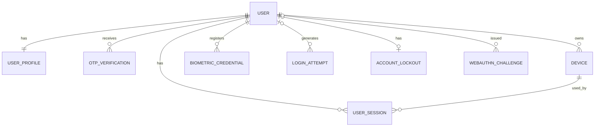

# Architecture

See the Phase 2 write-up for the full diagrams. Summary of what was built:

```
React (Vite) ──fetch + cookies + X-CSRFToken──► Django REST (thin views)
                                                  ├─ core        errors, CSRF, crypto helpers, headers
                                                  ├─ accounts    User, UserProfile, registration
                                                  ├─ otp         OTPVerification, delivery adapters
                                                  ├─ sessions_app Device, UserSession, auth class, single-device swap
                                                  ├─ webauthn_app BiometricCredential, WebAuthnChallenge
                                                  └─ security    LoginAttempt, AccountLockout, guard / record_*
                                                              ▼
                                                           MySQL 8
```

## Credential-check choke point

Every OTP and WebAuthn verification follows the same order (`security/flow.py`, `webauthn_app/services.py`):

1. `lockout.guard()` (refuse while locked, refuse abusive IPs)
2. verify the credential
3. `lockout.record_failure()` (increments / locks, returns the error to raise) **or** `lockout.record_success()` (resets)

## Data model



Key constraints: `UNIQUE(email)`, `UNIQUE(phone_e164)`, `CHECK(email OR phone)`, `UNIQUE(user, active_slot)` on sessions
(one active session per user), `UNIQUE(credential_id)`, `UNIQUE(token_hash)`, and `AccountLockout` keyed by exactly one of `user` / `identifier_hash`.
Model names in code: `User`, `UserProfile`, `OTPVerification`, `Device`, `UserSession`, `BiometricCredential`, `LoginAttempt`, `AccountLockout`, `WebAuthnChallenge`.
